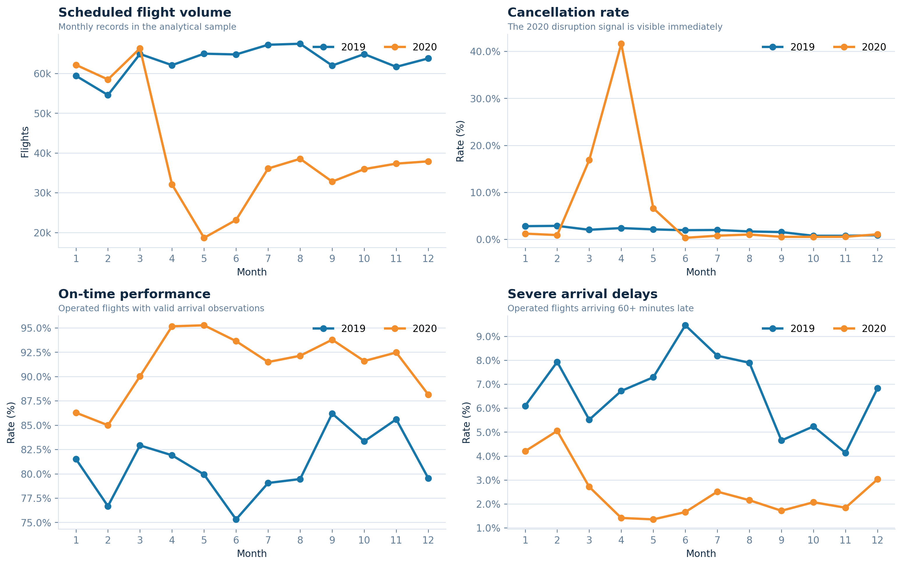
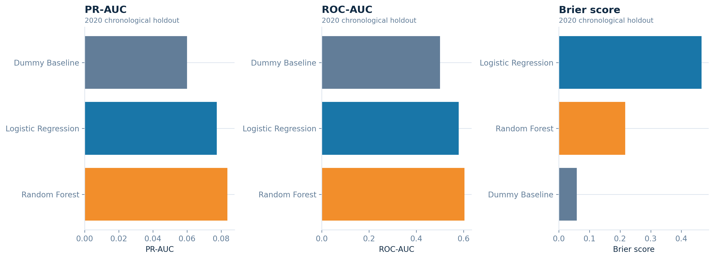
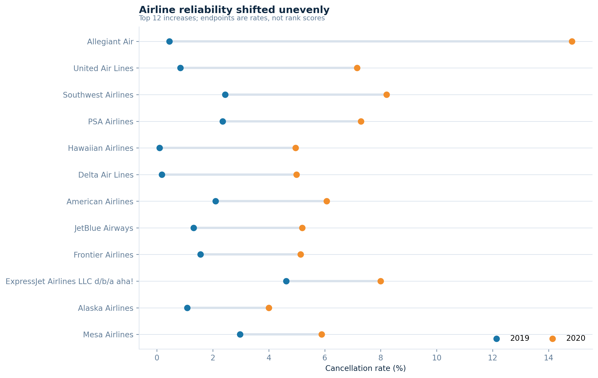
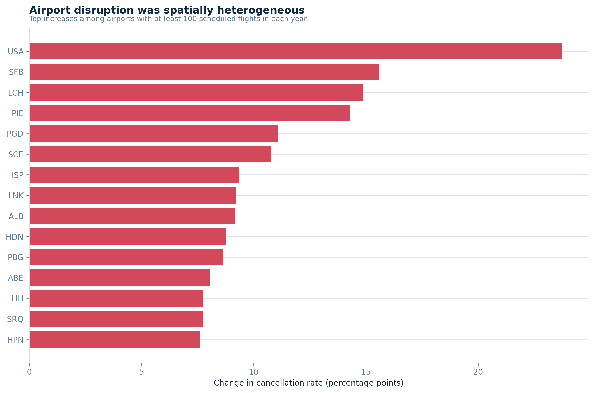
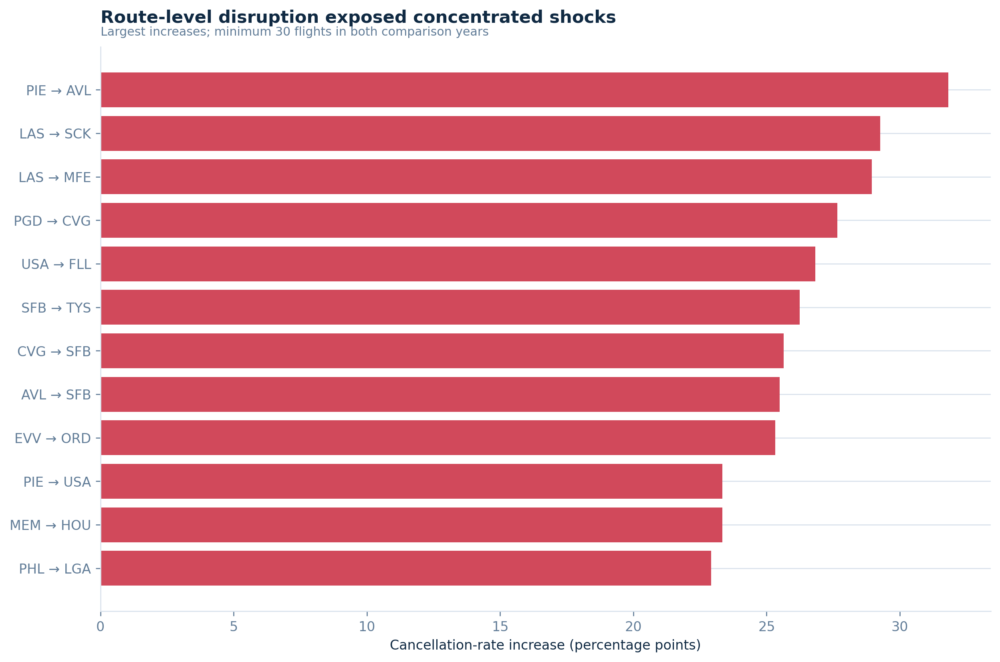
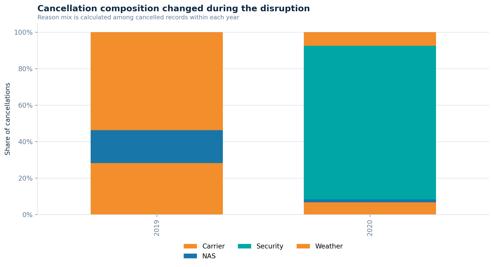
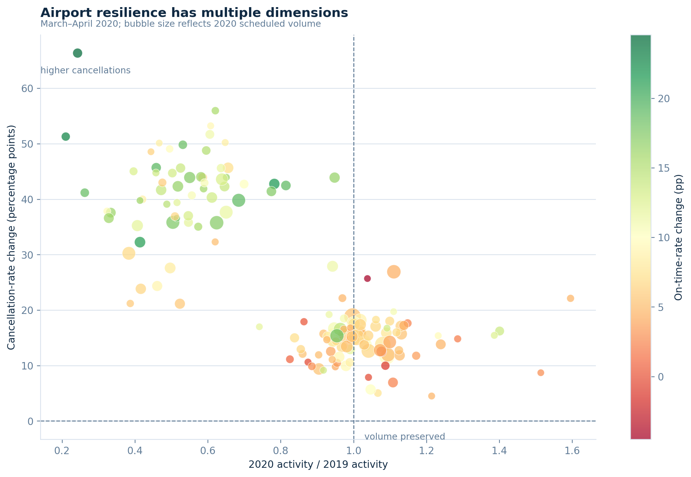

# U.S. Aviation Disruption Intelligence

## A reproducible analytics and data-engineering study of the 2019–2020 aviation shock

This project measures how scheduled U.S. flight operations changed during the first year of the COVID-19 disruption. It combines a validated data pipeline, analytical SQL, statistical inference, chronological machine learning, and an interactive dashboard into one reproducible workflow.

The emphasis is not on a single chart. It is on building an analysis that can be trusted: explicit denominators, leakage-safe features, entity-level minimum-volume thresholds, uncertainty intervals, validation checks, and a clear separation between raw data, materialized outputs, and presentation.

> **Scope note:** the included BTS-derived files are an analytical sample, not a claim about complete nationwide traffic. Percentages describe the records in this repository.

## Executive readout

The analysis contains **1,237,023 scheduled-flight records** across the 2019 baseline and 2020 disruption period:

| Signal | 2019 | 2020 | Interpretation |
|---|---:|---:|---|
| Scheduled records | 757,673 | 479,350 | Material contraction in observed activity |
| Cancellation rate | 1.79% | 6.00% | Cancellation risk increased substantially |
| Delay metric denominator | Operated flights with valid arrivals | Operated flights with valid arrivals | Delay metrics exclude cancelled flights and missing arrival delays |
| Data quality | 0 duplicate rows | 0 duplicate schedule keys | Validation gates passed |

The strongest business finding is that the shock was **not uniform**. Airline, airport, route, month, and cancellation-reason profiles moved differently. That makes aggregate averages useful for orientation, but insufficient for operational decision-making.



## What this project answers

- Which routes experienced the largest increase in cancellation rate?
- Which routes saw the largest deterioration in average arrival delay?
- How did cancellation composition change across carrier, NAS, and weather causes?
- Which airlines and airports showed the largest reliability shifts?
- How did March–April 2020 differ from the same months in 2019?
- Which airports preserved activity while limiting cancellation and on-time deterioration?
- How much predictive signal is available when a model is trained on 2019 and evaluated chronologically on 2020?

## Engineering design

```text
Data/flights_*.csv
        │
        ▼
src/analysis_pipeline.py ──► processed_data/*.csv
        │                         │
        ├── validation gates       ├── src/generate_figures.py ──► reports/figures/*.png
        ├── business questions     └── dashboard/app.py
        └── statistical + ML outputs
```

### Reproducible workflow

```powershell
# Install dependencies
python -m pip install -r requirements.txt

# Materialize validated analytical tables and model outputs
python src/analysis_pipeline.py

# Generate the README-ready figure set
python src/generate_figures.py

# Launch the interactive dashboard
streamlit run dashboard/app.py
```

The figure generator is intentionally downstream of the analytical pipeline. It consumes materialized CSV outputs rather than re-implementing business logic, which prevents the dashboard and README from silently drifting away from the authoritative metrics.

## Analytical approach

### Data quality and metric contracts

The pipeline validates required columns, date ranges, duplicate rows, duplicate schedule keys, cancellation flags, cancellation codes, airport identifiers, routes, and missingness patterns. Delay rates are calculated only for operated flights with a valid arrival-delay observation. Cancellation rates use scheduled flights as the denominator.

### Statistical analysis

- Wilson 95% confidence intervals for cancellation rates
- Two-proportion z-test for the 2019 versus 2020 cancellation-rate comparison
- Benjamini–Hochberg false-discovery-rate correction for airport-level comparisons
- Deterministic bootstrap intervals for selected mean-delay differences
- Minimum-volume thresholds to avoid presenting unstable entity-level percentages as operational facts

### Chronological machine learning

Models train on 2019 and test on 2020, avoiding random splits that would mix the baseline and disruption regimes. The feature set uses information available before departure: calendar fields, carrier, origin, destination, scheduled times, and distance. Post-departure leakage fields such as arrival delay and cancellation reason are excluded.



## Selected findings

### Airline reliability was uneven

The largest airline-level changes are not interchangeable. Some operators experienced a sharp cancellation-rate increase while their operated-flight delay profile improved, illustrating why cancellation and delay should be monitored as separate reliability dimensions.



### Route and airport exposure was concentrated

Entity-level analysis shows that disruption intensity varied substantially across the network. The route figures apply a minimum-volume rule, while the airport comparison requires at least 100 scheduled flights in each year.





### Cancellation composition also moved

Counting cancellations is not enough to explain the operating environment. The reason mix provides an additional diagnostic of how the disruption manifested in the observed schedule.



### Resilience is multidimensional

The resilience view compares activity preservation, cancellation-rate change, and on-time-rate change. A high-volume airport is not automatically resilient if it preserves traffic at the expense of reliability.



## Project structure

Only the primary execution and presentation surfaces are shown here:

```text
.
├── Data/
│   └── flights_2019.csv, flights_2020.csv
├── processed_data/
│   └── validated summaries, research outputs, and model metrics
├── reports/
│   └── figures/
├── dashboard/
│   └── app.py
├── src/
│   ├── analysis_pipeline.py
│   ├── generate_figures.py
│   ├── phase3_analysis.py
│   ├── research_pipeline.py
│   ├── ingest_bts.py
│   ├── data_layers.py
│   ├── load_postgres.py
│   └── postgres_existing.py
├── sql/
│   └── analytical and validation queries
├── requirements.txt
└── README.md
```

Internal engineering reports and exploratory notebooks are intentionally omitted from this high-level presentation map. They remain in `docs/` and `notebooks/` for reproducibility and auditability.

## Reproducibility and limitations

- Raw input files are excluded from Git history by `.gitignore`; obtain them from the project data source before running the pipeline.
- PostgreSQL integration is supported for validation and analytical querying, while the materialized local outputs keep the dashboard runnable without a live database.
- The observed period is 2019 versus 2020; it should not be presented as a complete causal estimate of the pandemic or as a post-pandemic recovery study.
- Route and airport comparisons are sensitive to sample volume and network composition. Thresholds, denominators, and missing-data rules are therefore part of the result contract.

## License and attribution

This repository is an analytical portfolio project. Source data attribution and provenance details are maintained with the project’s internal research materials.
